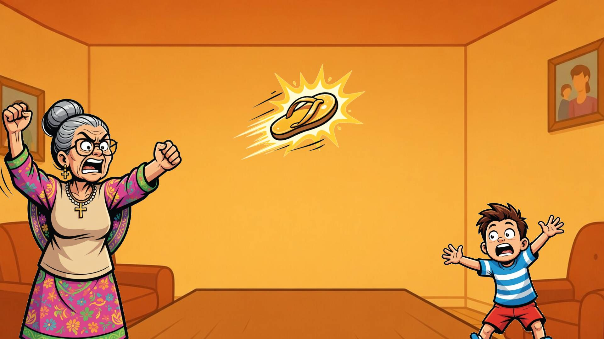

# Chanclazo — Chancla Strike

**3D browser survival game.** Dodge the chanclas in escalating waves of mom rage — a Latino culture love letter built with Three.js, React, and Cloudflare.

**Live:** [chanclazo.com](https://chanclazo.com)




## Features

- **Main 3D game (Three.js)** — multiple characters, Mexican / Día de los Muertos-inspired backgrounds, score + ghost replays  
- **Bonus 2D slingshot (Matter.js)** — piñata targets, particle hits, strikers (chancla, sugar skull, luchador head)  
- **Leaderboard, ghosts, live presence** — Cloudflare Worker + D1  
- **Mobile-first** full-screen play  

## Stack

| Layer | Tech |
|-------|------|
| Frontend | React 19, TypeScript, Vite, Three.js, Tailwind |
| Bonus physics | Matter.js |
| Backend | Cloudflare Workers + D1 |
| Hosting | Netlify (frontend + domain) + Cloudflare Worker API |

## Quick start

```powershell
npm install
npm run dev
npm run typecheck
npm run build
```

Local API uses the Vite proxy (`vite.config.ts`).

## Deploy notes

- Netlify: build `npm run build`, publish `dist`  
- Worker: `npm run deploy:worker` when API changes  
- See `NETLIFY_CUSTOM_DOMAIN.md` for chanclazo.com DNS / proxy  

## Contact

contact@chanclazo.com

## License

All rights reserved. Free to play; scores are public.
